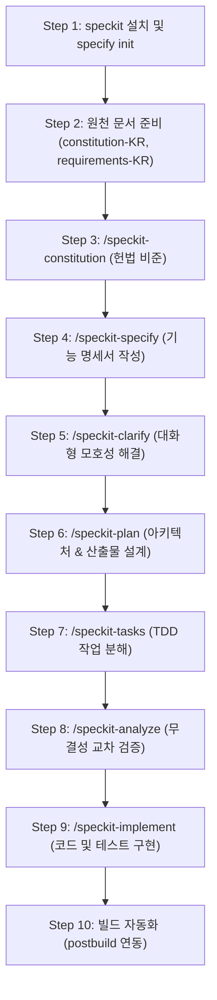

# Spec Kit (Spec-Driven Development) 활용 완벽 가이드

본 문서는 **Spec Kit(`https://github.com/github/spec-kit`)**을 활용하여 요구사항 명세화부터 아키텍처 설계, TDD 기반 구현, 품질 검증 및 Kubernetes Helm 배포 패키징까지 전체 **Spec-Driven Development (SDD)** 라이프사이클을 수행한 전 과정을 정리한 종합 가이드입니다.

---

## 📌 목차
1. [Spec-Driven Development (SDD) 개요](#1-spec-driven-development-sdd-개요)
2. [전체 워크플로우 한눈에 보기](#2-전체-워크플로우-한눈에-보기)
3. [단계별 상세 수행 가이드](#3-단계별-상세-수행-가이드)
   - [Step 1: 환경 구성 및 프로젝트 초기화](#step-1-환경-구성-및-프로젝트-초기화)
   - [Step 2: 초기 원천 문서 준비](#step-2-초기-원천-문서-준비)
   - [Step 3: 프로젝트 헌법 제정 (`/speckit-constitution`)](#step-3-프로젝트-헌법-제정-speckit-constitution)
   - [Step 4: 기능 명세서 생성 (`/speckit-specify`)](#step-4-기능-명세서-생성-speckit-specify)
   - [Step 5: 대화형 요구사항 명확화 (`/speckit-clarify`)](#step-5-대화형-요구사항-명확화-speckit-clarify)
   - [Step 6: 아키텍처 및 구현 계획 수립 (`/speckit-plan`)](#step-6-아키텍처-및-구현-계획-수립-speckit-plan)
   - [Step 7: 의존성 기반 작업 분해 (`/speckit-tasks`)](#step-7-의존성-기반-작업-분해-speckit-tasks)
   - [Step 8: 산출물 정합성 교차 분석 (`/speckit-analyze`)](#step-8-산출물-정합성-교차-분석-speckit-analyze)
   - [Step 9: TDD 기반 실제 구현 및 검증 (`/speckit-implement`)](#step-9-tdd-기반-실제-구현-및-검증-speckit-implement)
   - [Step 10: 클라이언트-백엔드 빌드 자동화 (`postbuild`)](#step-10-클라이언트-백엔드-빌드-자동화-postbuild)
4. [생성된 주요 산출물 구조](#4-생성된-주요-산출물-구조)
5. [Spec Kit 활용의 핵심 가치 및 실무 팁](#5-spec-kit-활용의-핵심-가치-및-실무-팁)

---

## 1. Spec-Driven Development (SDD) 개요

**Spec-Driven Development (명세 주도 개발)**은 코드를 먼저 작성하기 전에, 명확한 **원칙(Constitution)**, **기술 독립적인 기능 명세(Specification)**, **아키텍처 계획(Plan)**, **원자적 작업 목록(Tasks)**을 체계적으로 수립하고 검증한 후 구현에 착수하는 개발 방법론입니다.

- **목적**: 불명확한 요구사항으로 인한 재작업(Rework)을 사전에 차단하고, 일관된 고품질 코드와 테스트 커버리지를 보장합니다.
- **도구**: GitHub Spec Kit CLI 및 AI 에이전트 슬래시 커맨드(`speckit-*`).

---

## 2. 전체 워크플로우 한눈에 보기



---

## 3. 단계별 상세 수행 가이드

### Step 1: 환경 구성 및 프로젝트 초기화

터미널에서 `spec-kit` CLI를 준비하고, Antigravity 에이전트와 연동 가능한 프로젝트 구조를 생성합니다.

```bash
# 1. Spec Kit 도구 설치 (pipx / uv 등을 통해 전역 설치)
uv tool install specify-cli


# 2. Antigravity(AGY) 연동 모드로 신규 프로젝트 디렉터리 초기화
specify init spec-geeting-helm-antigravity-KR --integration agy

# 3. 프로젝트 루트로 이동
cd spec-geeting-helm-antigravity-KR
```

- **생성된 기반 디렉터리**:
  - `.specify/`: 템플릿, 공통 스크립트, 워크플로우 정의 및 메모리 저장소
  - `.agents/skills/`: 에이전트가 실행할 `speckit-*` 스킬 정의 파일 모음

---

### Step 2: 초기 원천 문서 준비

프로젝트의 기본 규칙과 기능 요구사항을 담은 원천 텍스트 문서를 루트에 준비합니다.

1. **`constitution-KR.txt`**: 프로젝트에서 지켜야 할 기본 철학 입력
   ```text
   코드품질, 테스트우선, 접근성, 성능원칙을 정의해줘.
   ```
2. **`requirements-KR.txt`**: 구현 대상인 Getting Started Todo App의 기술 스택, 엔드포인트, DB 저장소 및 UX 기능 명세가 기술된 요구사항 정의서.

---

### Step 3: 프로젝트 헌법 제정 (`/speckit-constitution`)

- **실행 명령**:
  ```text
  /speckit-constitution @constitution-KR.txt
  ```
- **수행 내용**:
  - `.specify/memory/constitution.md` 파일에 프로젝트의 타협 불가능한 4대 핵심 원칙 제정:
    1. **I. 코드 품질 (Code Quality)**: 모듈화, 책임 분리, ESLint 및 Prettier 무경고/무에러 준수
    2. **II. 테스트 우선 (Test-First - NON-NEGOTIABLE)**: TDD 사이클 준수, 단위 및 API 계약 테스트 선행 필수
    3. **III. 웹 접근성 (Accessibility - a11y)**: WCAG 2.1 AA, 100% 키보드 네비게이션, ARIA 라벨, 4.5:1 이상 명도 대비
    4. **IV. 성능 및 효율성 (Performance & Efficiency)**: UI 1초 이내 반영, P95 < 200ms API 응답, LCP < 2.5s
  - 기술 스택 제약사항(Node 22, Express, React, Helm, 시크릿 보안) 및 거버넌스 개정 절차 비준 (`v1.0.0`).

---

### Step 4: 기능 명세서 생성 (`/speckit-specify`)

- **실행 명령**:
  ```text
  /speckit-specify @requirements-KR.txt
  ```
- **수행 내용**:
  - `specs/001-todo-app-core/` 디렉터리 및 `spec.md` 생성.
  - **기술 비종속적(Technology-Agnostic)**이며 비즈니스/사용자 가치 중심의 명세 작성:
    - **P1**: 새로운 할 일 추가 (Add Todo)
    - **P1**: 할 일 목록 조회 및 상태 확인 (View Todo List)
    - **P2**: 할 일 완료 상태 토글 (Toggle Completion)
    - **P2**: 할 일 항목 즉시 삭제 (Delete Todo)
    - **P3**: 서비스 연결 상태 및 환영 배너 확인 (Greeting Banner)
  - 명세 품질 체크리스트(`checklists/requirements.md`) 자동 검증 통과 (16/16 항목 충족).

---

### Step 5: 대화형 요구사항 명확화 (`/speckit-clarify`)

- **실행 명령**:
  ```text
  /speckit-clarify
  ```
- **수행 내용**:
  - 아키텍처 및 구현 전에 남아있는 모호한 결정 사항을 에이전트가 1:1 대화형 질문을 통해 순차적으로 질의하고, 선택된 답변을 `spec.md`에 즉시 반영.
  - **해결된 5대 명확화 사항**:
    1. *목록 정렬 방식*: 등록 순서(오래된 순, FIFO) 정렬 채택
    2. *삭제 동작*: 확인 팝업 없는 즉각적인 영구 삭제 채택
    3. *작업 명칭 글자 수*: 최대 255자 제약 채택 (`VARCHAR(255)`)
    4. *네트워크 장애 피드백*: 화면 상단 비간섭형 경고 배너(Alert) 채택
    5. *동일 이름 중복*: 고유 UUID 기반 독립된 항목으로 중복 허용 채택

---

### Step 6: 아키텍처 및 구현 계획 수립 (`/speckit-plan`)

- **실행 명령**:
  ```text
  /speckit-plan
  ```
- **수행 내용**:
  - 헌법 게이트(Constitution Check) 사전 검증 (모든 게이트 **PASS**).
  - **Phase 0 & Phase 1 산출물 생성**:
    - `plan.md`: 기술 컨텍스트(Express 5.x, React 19, SQLite/MySQL, Helm), 프로젝트 소스 구조 정의
    - `research.md`: 듀얼 DB 추상화, Graceful Shutdown, a11y 대응 등 아키텍처 결정서
    - `data-model.md`: `TodoItem`, `Greeting` 엔티티, SQLite/MySQL DDL, 상태 전이 다이어그램
    - `contracts/todo-api.yaml`: OpenAPI 3.1.0 기반 REST API 엔드포인트 명세
    - `quickstart.md`: E2E 테스트 및 로컬/컨테이너 구동 검증 시나리오

---

### Step 7: 의존성 기반 작업 분해 (`/speckit-tasks`)

- **실행 명령**:
  ```text
  /speckit-tasks
  ```
- **수행 내용**:
  - 구현 계획과 기능 명세를 바탕으로 실행 가능한 **41개의 세부 태스크(`T001` ~ `T041`)** 생성 (`specs/001-todo-app-core/tasks.md`).
  - **Test-First 원칙 준수**: 각 사용자 스토리 구현 전 실패하는 단위/계약 테스트(`[USx] ... .spec.js`)를 최우선 태스크로 배치.
  - 병렬 수행 가능 태스크(`[P]`) 및 스토리별 의존성 흐름도(Mermaid) 정의.
  - 명확한 MVP 범위(Phase 1 Setup + Phase 2 Foundation + Phase 3 US1 + Phase 4 US2) 도출.

---

### Step 8: 산출물 정합성 교차 분석 (`/speckit-analyze`)

- **실행 명령**:
  ```text
  /speckit-analyze
  ```
- **수행 내용**:
  - `spec.md`, `plan.md`, `tasks.md`, `constitution.md` 간의 비파괴(Read-Only) 무결성 검증.
  - **분석 결과**:
    - 치명적 결함(Critical Issues): **0건**
    - 모호성 및 중복: **0건**
    - 요구사항 커버리지: **100%** (18/18개 기능 요구사항 및 성공 기준 전체 매핑)
    - 헌법 정합성: **ALL PASS**

---

### Step 9: TDD 기반 실제 구현 및 검증 (`/speckit-implement`)

- **실행 명령**:
  ```text
  /speckit-implement
  ```
- **수행 내용**:
  - 사전 체크리스트(`checklists/requirements.md`) 게이트 통과 확인 (16/16).
  - 프로젝트 공통 무시 파일 생성 (`.gitignore`, `.dockerignore`, `.eslintignore`, `.prettierignore`, `.helmignore`).
  - **백엔드 구축 (`backend/`)**:
    - `src/persistence/`: SQLite (`sqlite3`) 및 MySQL (`mysql2`, `wait-port`) 듀얼 드라이버
    - `src/routes/`: 라우터 분리 (`addItem`, `getItems`, `updateItem`, `deleteItem`, `getGreeting`)
    - `src/index.js`: Express 5.x 서버, 정적 파일 서빙, Graceful Shutdown
    - `spec/routes/`: Jest 단위 및 계약 테스트 10개 작성 및 통과 (**10/10 PASS**)
  - **클라이언트 구축 (`client/`)**:
    - React 19 + Vite + React-Bootstrap + FontAwesome 기반 UI
    - `AddNewItemForm.jsx`, `TodoListCard.jsx`, `ItemDisplay.jsx`, `Greeting.jsx`, `App.jsx`
    - WCAG 2.1 AA 명도 대비(4.5:1 이상) 및 키보드 네비게이션 보장
  - **배포 인프라 구축**:
    - `helm/todo-app/`: Chart.yaml, values.yaml, Deployment, Service, Ingress, Secret (`helm lint` 통과)
    - `Dockerfile`: 멀티스테이지 컨테이너 빌드 정의
    - `compose.yaml`: Traefik v3.6, Todo App, MySQL 9.3, phpMyAdmin 서비스 오케스트레이션
  - `tasks.md`의 모든 태스크(T001 ~ T041)를 완료 처리(`[X]`)로 업데이트.

---

### Step 10: 클라이언트-백엔드 빌드 자동화 (`postbuild`)

- **수행 내용**:
  - 클라이언트 빌드 산출물(`client/dist`)이 백엔드의 정적 서빙 경로(`backend/src/static`)로 자동 복사되도록 [`client/package.json`](file:///d:/Lecture%20Notes/2026-2CloudComputing/practices/07week/Extention%20of%20getting-started-todo-app-basedon%20Helm/spec-geeting-helm-antigravity-KR/client/package.json)의 `"scripts"`에 `postbuild`를 추가.
  ```json
  "scripts": {
    "dev": "vite --host=0.0.0.0",
    "build": "vite build",
    "postbuild": "node -e \"const fs=require('fs'); fs.rmSync('../backend/src/static', {recursive:true, force:true}); fs.cpSync('dist', '../backend/src/static', {recursive:true});\"",
    "lint": "eslint . --report-unused-disable-directives --max-warnings 0",
    "preview": "vite preview",
    "format": "prettier --write \"**/*.{js,jsx}\"",
    "format-check": "prettier --check \"**/*.{js,jsx}\""
  }
  ```
- **검증**: `client` 디렉터리에서 `npm run build`를 실행하면 `postbuild`가 연쇄 트리거되어 Windows, Linux, macOS에 무관하게 항상 최신 클라이언트 번들이 백엔드 정적 디렉터리로 복사됨.

---

## 4. 생성된 주요 산출물 구조

```text
spec-geeting-helm-antigravity-KR/
├── .specify/                         # Spec Kit 핵심 구성 및 헌법
│   ├── memory/
│   │   └── constitution.md           # 프로젝트 헌법 v1.0.0
│   └── feature.json                  # 활성 기능 경로 메타데이터
├── specs/
│   └── 001-todo-app-core/            # 1호 기능 명세 패키지
│       ├── spec.md                   # 비즈니스 기능 명세서
│       ├── plan.md                   # 아키텍처 및 구현 계획서
│       ├── research.md               # 기술 결정 연구서 (Phase 0)
│       ├── data-model.md             # 데이터 모델 및 DDL (Phase 1)
│       ├── quickstart.md             # E2E 검증 시나리오 (Phase 1)
│       ├── contracts/
│       │   └── todo-api.yaml         # OpenAPI 3.1 REST API 명세
│       ├── checklists/
│       │   └── requirements.md       # 명세 품질 체크리스트
│       └── tasks.md                  # 41개 태스크 체크리스트 (모두 [X] 완료)
├── backend/                          # Express 5.x 백엔드
│   ├── src/                          # 라우터, DB 드라이버, 서버 진입점
│   ├── spec/                         # Jest 단위 및 계약 테스트 (10/10 PASS)
│   └── package.json
├── client/                           # React 19 + Vite 클라이언트
│   ├── src/                          # 컴포넌트, SCSS 고대비 스타일
│   ├── dist/                         # 컴파일된 프로덕션 번들
│   └── package.json                  # postbuild 스크립트 포함
├── helm/
│   └── todo-app/                     # Kubernetes Helm 차트 (lint PASS)
├── Dockerfile                        # 멀티스테이지 프로덕션 이미지 정의
├── compose.yaml                      # Traefik + MySQL + App 로컬 통합 환경
└── speckit-활용.md                   # 본 전체 활용 가이드 문서
```

---

## 5. Spec Kit 활용의 핵심 가치 및 실무 팁

1. **헌법(Constitution)의 강제력**:
   - 코드 품질이나 테스트 우선 원칙을 말로만 합의하는 것이 아니라, `constitution.md`로 비준하여 계획 수립(`plan.md`)과 분석(`analyze`) 단계의 필수 게이트로 자동 검증합니다.
2. **명세(Spec)와 계획(Plan)의 분리**:
   - `spec.md`는 기술 용어를 배제하고 **사용자 가치와 Acceptance Criteria**에만 집중합니다.
   - 기술 스택, 라이브러리, DB 테이블 등은 `plan.md`와 `data-model.md`에서 다룹니다.
3. **대화형 명확화(`clarify`)의 위력**:
   - 코딩을 시작하기 전 정렬 기준, 삭제 동작, 글자 수 제한 등의 세부 결정을 확정함으로써 나중에 발생할 수 있는 대규모 수정 비용을 '0'으로 만듭니다.
4. **TDD 태스크 자동 정렬**:
   - `tasks.md`에서 각 기능마다 테스트 태스크를 구현 태스크 앞에 배치함으로써 테스트 코드가 누락되는 일을 원천 방지합니다.
5. **독립 검증 가능한 단위 전달**:
   - 사용자 스토리별(US1~US5)로 독립적인 테스트와 배포가 가능하므로, 최소 기능 제품(MVP)을 빠르게 배포하고 점진적으로 기능을 확장할 수 있습니다.

