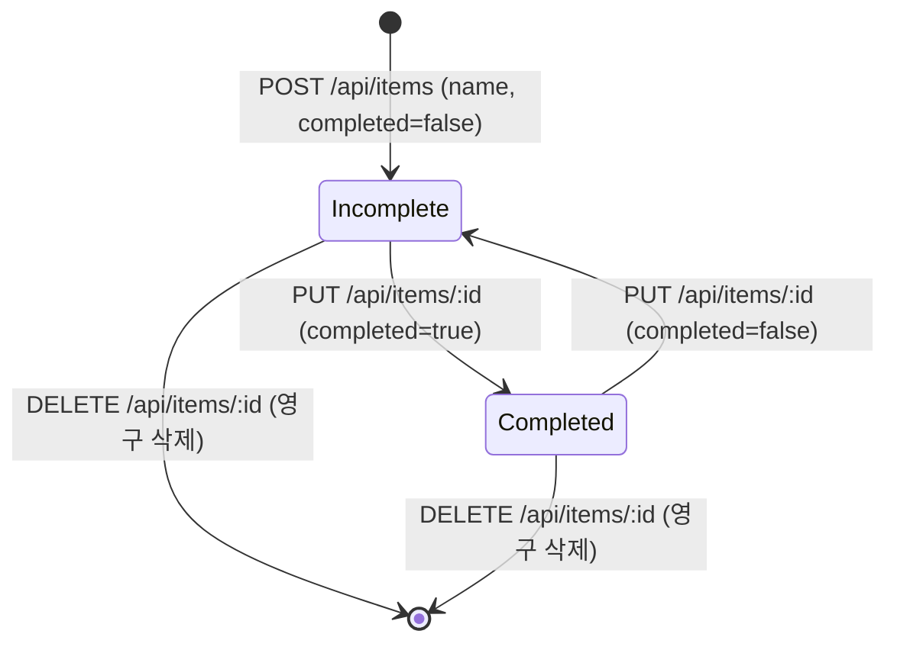

# Phase 1 Data Model: Todo App Core

## 1. 개요 (Overview)

본 문서는 Todo App Core 기능에서 사용되는 엔티티 구조, 데이터베이스 스키마(MySQL 및 SQLite), 유효성 검증 규칙, 수명 주기 및 상태 전이 다이어그램을 정의합니다.

---

## 2. 엔티티 정의 (Entities)

### 2.1 TodoItem (할 일 항목)

사용자가 등록하고 관리하는 개별 할 일 작업을 나타냅니다.

| 필드명 | 타입 | 필수 여부 | 기본값 | 설명 및 제약조건 |
| :--- | :--- | :---: | :---: | :--- |
| `id` | String (UUID v4) | 필수 | - | 고유 식별자 (36자 문자열, 예: `550e8400-e29b-41d4-a716-446655440000`) |
| `name` | String (VARCHAR) | 필수 | - | 작업 명칭 (최소 1자, 최대 255자, 공백만으로 구성 금지, 동일 명칭 중복 허용) |
| `completed` | Boolean / Integer | 필수 | `false` / `0` | 완료 여부 (0: 미완료, 1: 완료) |

### 2.2 Greeting (인사말 엔티티)

백엔드 서버 구동 및 헬스 상태 확인을 위한 시스템 환영 메시지입니다.

| 필드명 | 타입 | 필수 여부 | 기본값 | 설명 |
| :--- | :--- | :---: | :---: | :--- |
| `greeting` | String | 필수 | `"Hello world!"` | 시스템 환영 메시지 텍스트 |

---

## 3. 데이터베이스 스키마 (Database Schemas)

### 3.1 SQLite DDL (`sqlite.js`)

```sql
CREATE TABLE IF NOT EXISTS todo_items (
    id VARCHAR(36) PRIMARY KEY,
    name VARCHAR(255) NOT NULL,
    completed BOOLEAN NOT NULL DEFAULT 0
);
```

### 3.2 MySQL DDL (`mysql.js`)

```sql
CREATE TABLE IF NOT EXISTS todo_items (
    id VARCHAR(36) PRIMARY KEY,
    name VARCHAR(255) NOT NULL,
    completed BOOLEAN NOT NULL DEFAULT FALSE
) ENGINE=InnoDB DEFAULT CHARSET=utf8mb4 COLLATE=utf8mb4_unicode_ci;
```

---

## 4. 유효성 검증 규칙 (Validation Rules)

1. **`id` 검증**:
   - RFC 4122 규격의 유효한 UUID v4 형식이어야 한다.
   - 신규 생성 시 서버 측에서 `uuid.v4()`를 통해 자동 부여한다.
2. **`name` 검증**:
   - 필수 입력값이어야 한다 (`null` 또는 `undefined` 불가).
   - 앞뒤 공백을 제거(`trim()`)한 후 길이가 최소 1자 이상이어야 한다.
   - 최대 길이는 255자를 초과할 수 없다 (초과 시 400 Bad Request).
   - 기존 항목과 동일한 명칭이 존재하더라도 고유 `id`를 기반으로 등록을 허용한다.
3. **`completed` 검증**:
   - 불리언(`true`/`false`) 또는 0/1 정수여야 한다.
   - 신규 등록 시 기본값은 항상 `false`(미완료)로 설정된다.

---

## 5. 상태 전이 모델 (State Transitions)



---

## 6. 정렬 및 조회 규칙 (Ordering & Querying)

- **조회 정렬**: `SELECT * FROM todo_items`
  - 데이터베이스 삽입 순서(오래된 항목 상단, 신규 항목 하단)를 유지하여 반환한다.
- **삭제 정책**: 물리적 삭제(Hard Delete)를 적용하여 데이터베이스에서 영구 제거한다.

