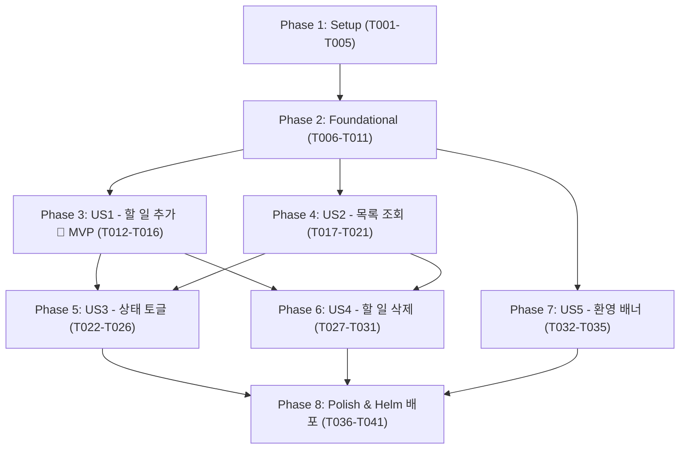

# Tasks: Todo App Core (할 일 관리 기본 기능)

**Input**: Design documents from `specs/001-todo-app-core/`
**Prerequisites**: `plan.md`, `spec.md`, `research.md`, `data-model.md`, `contracts/todo-api.yaml`, `quickstart.md`, `.specify/memory/constitution.md`

**Tests**: 헌법 제2원칙(Test-First - NON-NEGOTIABLE)에 따라 모든 API 라우트 및 핵심 로직에 대한 Jest 단위/계약 테스트를 구현 전 선행 작성합니다.

**Organization**: 각 사용자 스토리(US1~US5)별로 독립적인 구현 및 테스트가 가능하도록 구성되었습니다.

## Format: `- [ ] [TaskID] [P?] [Story?] Description with file path`

- **[P]**: 병렬 수행 가능 (별도 파일, 선행 미완료 의존성 없음)
- **[Story]**: 해당 사용자 스토리 매핑 ([US1] ~ [US5])
- 모든 작업 항목에 명시적 파일 경로 포함

---

## Phase 1: Setup (Shared Infrastructure)

**Purpose**: 프로젝트 기본 디렉터리 구성 및 백엔드/클라이언트 의존성 및 린트 환경 초기화

- [ ] T001 Create project directories (`backend/src/routes`, `backend/src/persistence`, `backend/spec/routes`, `client/src/components`, `helm/todo-app/templates`) per implementation plan
- [ ] T002 Initialize backend dependencies (express ^5.1.0, mysql2 ^3.14.1, sqlite3 ^5.1.7, uuid ^11.1.0, wait-port ^1.1.0, jest ^29.7.0) in `backend/package.json`
- [ ] T003 [P] Initialize client dependencies (react ^19.1.0, react-dom ^19.1.0, react-bootstrap ^2.10.10, bootstrap ^5.3.6, @fortawesome icons, vite ^6.3.5, sass ^1.62.1) in `client/package.json`
- [ ] T004 [P] Configure ESLint and Prettier formatting rules in `backend/.prettierrc` and `client/.eslintrc.cjs`
- [ ] T005 [P] Setup Traefik reverse proxy and multi-service orchestration in `compose.yaml`

---

## Phase 2: Foundational (Blocking Prerequisites)

**Purpose**: 모든 사용자 스토리가 의존하는 공통 데이터베이스 추상화 계층, Express 서버 진입점 및 클라이언트 셸 구축

**⚠️ CRITICAL**: 이 단계가 완료되기 전에는 어떠한 사용자 스토리도 착수할 수 없습니다.

- [ ] T006 Implement database interface factory and driver loader (switching on `MYSQL_HOST`) in `backend/src/persistence/index.js`
- [ ] T007 [P] Implement SQLite database initialization and table creation (`CREATE TABLE IF NOT EXISTS todo_items (id VARCHAR(36) PRIMARY KEY, name VARCHAR(255) NOT NULL, completed BOOLEAN NOT NULL DEFAULT 0)`) in `backend/src/persistence/sqlite.js`
- [ ] T008 [P] Implement MySQL connection handler with wait-port and table creation (`CREATE TABLE IF NOT EXISTS todo_items (id VARCHAR(36) PRIMARY KEY, name VARCHAR(255) NOT NULL, completed BOOLEAN NOT NULL DEFAULT FALSE) ENGINE=InnoDB`) in `backend/src/persistence/mysql.js`
- [ ] T009 Create Express server with JSON parser, static assets routing, and graceful shutdown (handling SIGINT, SIGTERM, SIGUSR2) in `backend/src/index.js`
- [ ] T010 [P] Configure Vite dev server with proxy settings and Sass support in `client/vite.config.js`
- [ ] T011 [P] Create main React application root and WCAG 2.1 AA high-contrast stylesheet in `client/src/main.jsx` and `client/src/App.scss`

**Checkpoint**: 기본 인프라 및 저장소 준비 완료 - 이제 사용자 스토리 개발을 착수할 수 있습니다.

---

## Phase 3: User Story 1 - 새로운 할 일 추가 (Priority: P1) 🎯 MVP

**Goal**: 사용자가 작업 명칭(1~255자)을 입력하고 Enter 키 또는 추가 버튼을 눌러 새 할 일을 등록할 수 있다.

**Independent Test**: 빈 문자열 차단 검증 후 정상 명칭 입력 시 `POST /api/items`가 201 응답과 UUID v4, `completed: false`를 반환하고 UI 입력창이 초기화되는지 확인.

### Tests for User Story 1 (Test-First) ⚠️

- [ ] T012 [P] [US1] Unit and contract tests for POST /api/items (verifying UUID generation, 1..255 char constraint, whitespace rejection, duplicate name allowance, and 201 response) in `backend/spec/routes/addItem.spec.js`

### Implementation for User Story 1

- [ ] T013 [US1] Implement `storeItem` method (inserting `id`, `name`, `completed=false`) in `backend/src/persistence/sqlite.js` and `backend/src/persistence/mysql.js`
- [ ] T014 [US1] Implement POST /api/items route handler with input validation (1~255 chars, trim whitespace) in `backend/src/routes/addItem.js`
- [ ] T015 [P] [US1] Implement `AddNewItemForm` component with accessible form label, input validation (empty/whitespace disable), and "Adding..." loading state in `client/src/components/AddNewItemForm.jsx`
- [ ] T016 [US1] Integrate item creation API call and top error banner (Alert) state in `client/src/App.jsx`

**Checkpoint**: User Story 1 (새로운 할 일 등록)이 독립적으로 완전히 동작하고 검증 가능함 (MVP 달성).

---

## Phase 4: User Story 2 - 할 일 목록 조회 및 상태 확인 (Priority: P1)

**Goal**: 사용자가 접속 시 등록된 모든 할 일을 등록 순(FIFO)으로 확인하고, 빈 목록 시 안내 문구를 확인한다.

**Independent Test**: `GET /api/items`가 등록 순서(오래된 순)로 배열을 반환하며, 클라이언트에서 로딩 스피너 및 빈 목록 메시지("No items yet! Add one above!")가 정상 노출되는지 확인.

### Tests for User Story 2 (Test-First) ⚠️

- [ ] T017 [P] [US2] Unit and contract tests for GET /api/items (verifying FIFO order array response and empty array on no data) in `backend/spec/routes/getItems.spec.js`

### Implementation for User Story 2

- [ ] T018 [US2] Implement `getItems` query method (fetching items in FIFO order) in `backend/src/persistence/sqlite.js` and `backend/src/persistence/mysql.js`
- [ ] T019 [US2] Implement GET /api/items route handler in `backend/src/routes/getItems.js`
- [ ] T020 [P] [US2] Implement `TodoListCard` component with loading indicator, empty state message, and item list container in `client/src/components/TodoListCard.jsx`
- [ ] T021 [US2] Integrate items fetch lifecycle and state synchronization on mount in `client/src/App.jsx`

**Checkpoint**: User Story 1 및 2가 결합되어 할 일 등록 및 목록 조회가 완벽하게 동작함.

---

## Phase 5: User Story 3 - 할 일 완료 상태 토글 (Priority: P2)

**Goal**: 사용자가 체크박스를 클릭하여 할 일 완료 여부를 토글(완료 ↔ 미완료)하고 시각적 취소선 스타일을 확인한다.

**Independent Test**: `PUT /api/items/:id` 호출 시 `completed` 플래그가 반전되어 저장되고 UI에서 취소선 스타일이 즉시 적용/복원되는지 확인.

### Tests for User Story 3 (Test-First) ⚠️

- [ ] T022 [P] [US3] Unit and contract tests for PUT /api/items/:id (updating completed status and name, returning 200 or 404) in `backend/spec/routes/updateItem.spec.js`

### Implementation for User Story 3

- [ ] T023 [US3] Implement `updateItem` method in `backend/src/persistence/sqlite.js` and `backend/src/persistence/mysql.js`
- [ ] T024 [US3] Implement PUT /api/items/:id route handler in `backend/src/routes/updateItem.js`
- [ ] T025 [P] [US3] Implement `ItemDisplay` component with FontAwesome checkbox icon, keyboard space/enter toggle, and "completed" CSS class in `client/src/components/ItemDisplay.jsx`
- [ ] T026 [US3] Connect completion toggle callback between `ItemDisplay` and state in `client/src/App.jsx`

**Checkpoint**: User Story 3 (완료 상태 토글)이 독립적으로 검증 가능함.

---

## Phase 6: User Story 4 - 할 일 항목 삭제 (Priority: P2)

**Goal**: 사용자가 휴지통 아이콘을 누르면 확인 팝업 없이 즉시 영구 삭제된다.

**Independent Test**: `DELETE /api/items/:id` 호출 시 200 응답을 반환하고 DB에서 삭제되며 UI 목록에서 즉시 제거되는지 확인.

### Tests for User Story 4 (Test-First) ⚠️

- [ ] T027 [P] [US4] Unit and contract tests for DELETE /api/items/:id (verifying immediate deletion and 200 OK) in `backend/spec/routes/deleteItem.spec.js`

### Implementation for User Story 4

- [ ] T028 [US4] Implement `removeItem` method in `backend/src/persistence/sqlite.js` and `backend/src/persistence/mysql.js`
- [ ] T029 [US4] Implement DELETE /api/items/:id route handler in `backend/src/routes/deleteItem.js`
- [ ] T030 [P] [US4] Add accessible trash icon button with `aria-label="Delete item: {name}"` in `client/src/components/ItemDisplay.jsx`
- [ ] T031 [US4] Connect deletion callback and optimistic UI update in `client/src/App.jsx`

**Checkpoint**: User Story 4 (즉시 영구 삭제)가 독립적으로 검증 가능함.

---

## Phase 7: User Story 5 - 서비스 연결 상태 및 환영 배너 확인 (Priority: P3)

**Goal**: 화면 상단에서 서비스 환영 인사말("Hello world!")을 확인하여 백엔드와의 연결을 인지한다.

**Independent Test**: `GET /api/greeting` 호출 시 `{"greeting":"Hello world!"}`가 반환되고 브라우저 상단 배너에 렌더링되는지 확인.

### Tests for User Story 5 (Test-First) ⚠️

- [ ] T032 [P] [US5] Unit and contract tests for GET /api/greeting in `backend/spec/routes/getGreeting.spec.js`

### Implementation for User Story 5

- [ ] T033 [US5] Implement GET /api/greeting route handler in `backend/src/routes/getGreeting.js`
- [ ] T034 [P] [US5] Implement `Greeting` banner component in `client/src/components/Greeting.jsx`
- [ ] T035 [US5] Integrate `Greeting` component and initial greeting fetch in `client/src/App.jsx`

**Checkpoint**: 전체 5대 사용자 스토리(US1~US5) 구현 및 독립 검증 완료.

---

## Phase 8: Polish, Packaging & Deployment Infrastructure

**Purpose**: Kubernetes Helm 차트 배포 매니페스트 작성, 멀티스테이지 Dockerfile 구성 및 종합 품질 검증

- [ ] T036 Create Helm chart metadata and configurable values in `helm/todo-app/Chart.yaml` and `helm/todo-app/values.yaml`
- [ ] T037 [P] Create Kubernetes Deployment and Service templates in `helm/todo-app/templates/deployment.yaml` and `helm/todo-app/templates/service.yaml`
- [ ] T038 [P] Create Kubernetes Ingress and Secret templates in `helm/todo-app/templates/ingress.yaml` and `helm/todo-app/templates/secret.yaml`
- [ ] T039 [P] Create production multi-stage Dockerfile serving backend and compiled client in `Dockerfile`
- [ ] T040 Run end-to-end quickstart validation scenarios from `specs/001-todo-app-core/quickstart.md`
- [ ] T041 Run automated ESLint, Prettier format check, and full Jest test suites (`npm test` in `backend` and `client`)

---

## Dependencies & Execution Order

### Phase Dependencies

### User Story Dependencies

- **User Story 1 (P1)**: Foundational 완료 후 즉시 착수 가능 (타 스토리 의존성 없음)
- **User Story 2 (P1)**: Foundational 완료 후 즉시 착수 가능 (US1과 병렬 개발 가능)
- **User Story 3 (P2)**: US1 및 US2 완료 후 목록 아이템(`ItemDisplay`) 컴포넌트에 토글 기능 확장
- **User Story 4 (P2)**: US1 및 US2 완료 후 목록 아이템(`ItemDisplay`) 컴포넌트에 삭제 기능 확장
- **User Story 5 (P3)**: Foundational 완료 후 완전히 독립적으로 진행 가능

### Parallel Execution Examples

- **Phase 1 (Setup)**: T003, T004, T005 동시 병렬 실행 가능
- **Phase 2 (Foundational)**: T007(SQLite)과 T008(MySQL), T010(Vite config)과 T011(App.scss) 병렬 실행 가능
- **Phase 3 (US1)**: T012(테스트)와 T015(UI 컴포넌트) 병렬 실행 가능
- **Phase 8 (Polish)**: T037(Deployment/Service), T038(Ingress/Secret), T039(Dockerfile) 동시 작성 가능

---

## Implementation Strategy

### MVP First (User Story 1 & 2)

1. Phase 1: Setup 및 Phase 2: Foundational 완료
2. Phase 3: User Story 1(추가) 및 Phase 4: User Story 2(조회) 완성
3. **STOP & VALIDATE**: 로컬 환경에서 할 일 추가 및 목록 노출을 독립적으로 테스트하여 핵심 MVP 완성 확인

### Incremental Delivery

1. MVP 달성 후 Phase 5(완료 토글) 추가 검증
2. Phase 6(즉시 삭제) 추가 검증
3. Phase 7(환영 배너) 추가 검증
4. Phase 8(Helm 차트 및 Docker 컨테이너 패키징, CI/CD 품질 게이트) 최종 검증
